# Lewis Moten

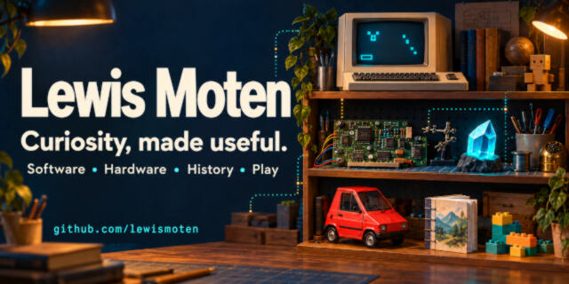

**Senior front-end engineer | React, TypeScript, and applied AI**

I turn complex data and workflows into usable web applications. I've programmed professionally since 1997, and my recent work spans interactive front ends, small local AI models, browser tools, and the infrastructure that runs them. I'm based in Front Royal, Virginia and interested in senior front-end engineering and AI application roles.

[Portfolio site](https://github.lewismoten.com/) · [Career history](https://lewismoten.com/employment/) · [Blog](https://lewismoten.com/blog/) · [Email](mailto:lewismoten@gmail.com) · [LinkedIn](https://www.linkedin.com/in/lewismoten/)

**Career documents:** [Introduction letter (PDF)](./resume/current/intro-letter-for-lewis-moten.pdf) · [Resume (PDF)](./resume/current/resume-for-lewis-moten.pdf) · [Selected projects (PDF)](./resume/current/selected-projects-for-lewis-moten.pdf)

## Start here

- **React and TypeScript:** [Public-ledger explorer](https://github.com/lewismoten/wcfac-general-ledger) — filtering and visualizing public financial data.
- **Applied AI:** [Crystal-9](https://github.com/lewismoten/crystal-9) — a compact, validated MoE model built for tight memory limits.
- **Server operations:** [Zogograph Client](https://github.com/lewismoten/zogograph-client) — telemetry, alerts, and AI-assisted diagnostics with cost tracking.
- **Interactive tools:** [D64 Storage Lab](https://lewismoten.github.io/storage-d64/) — visual disk repair, recovery, and read-efficiency experiments.

## What I work with

- **Front end:** React, TypeScript, JavaScript, accessible interfaces, data visualization, and browser APIs.
- **Applied AI:** PyTorch, model training and validation, MoE architectures, Ollama, llama.cpp, local inference, and tool calling.
- **Services and delivery:** Node.js, PHP, C#/.NET, SQLite and SQL, Linux hosting, Forgejo, CI/CD, and WHM/cPanel automation. 

## Projects

Each project's **More details** page on [my portfolio site](https://github.lewismoten.com/projects/) has an executive summary and a technical overview. Palace-9, Crystal-9, Crystal Palace 9 and Falken-9 are one series, compared side by side in [The tic-tac-toe models](https://github.lewismoten.com/series/tic-tac-toe-models/).

<!-- PROJECTS:START -->
### Applied AI and model engineering

| Project image&nbsp;&nbsp;&nbsp;&nbsp;&nbsp;&nbsp;&nbsp;&nbsp;&nbsp;&nbsp;&nbsp;&nbsp;&nbsp;&nbsp;&nbsp;&nbsp;&nbsp;&nbsp;&nbsp;&nbsp;&nbsp;&nbsp;&nbsp;&nbsp;&nbsp;&nbsp;&nbsp;&nbsp;&nbsp;&nbsp;&nbsp;&nbsp;&nbsp;&nbsp;&nbsp;&nbsp;&nbsp;&nbsp;&nbsp;&nbsp;&nbsp;&nbsp;&nbsp;&nbsp;&nbsp;&nbsp;&nbsp;&nbsp; | Project |
| :--- | :--- |
|  | **Local Agent Lab \| Portable AI workspace** Built a private React and TypeScript AI workspace for chat, code, images, and audio. Runs models in the browser or on a local Ollama server, so it works offline and conversations never have to leave the device; API providers are optional. Projects stay in a folder or on a removable drive. [Live demo](https://lewismoten.github.io/local-agent-lab/) · [Source](https://github.com/lewismoten/local-agent-lab) · [More details](https://github.lewismoten.com/projects/local-agent-lab/) |
| <a href="https://github.com/lewismoten/ghostjack">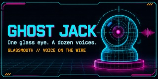</a> | **Ghost Jack \| Eyes, ears and a mouth for AI agents** Built a local bridge and cyberpunk control deck that gives people and AI agents eyes, ears and a mouth through a $2 thrift-store pan/tilt camera, with no cloud app. Reverse-engineered its sign-in, live RTSP stream, pan/tilt, night vision and speaker (found through the vendor's old Flash engine), with recording and a three.js aiming model. [Live demo](https://lewismoten.github.io/ghostjack/) · [Source](https://github.com/lewismoten/ghostjack) · [More details](https://github.lewismoten.com/projects/ghostjack/) |
| <a href="https://github.com/lewismoten/crystal-9">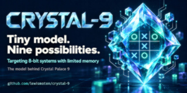</a> | **Crystal-9 \| Tiny MoE for 8-bit hardware** Redesigned a sparse MoE tic-tac-toe policy for a 13-token vocabulary and tight memory budgets. Released a 46,299-byte packed INT4 artifact for a custom local runtime, with zero policy misses across 294,778 legal histories. A compact adaptation powers Crystal Palace 9 on the C64. [Source](https://github.com/lewismoten/crystal-9) · [Hugging Face](https://huggingface.co/lewismoten/crystal-9) · [More details](https://github.lewismoten.com/projects/crystal-9/) |
| <a href="https://github.com/lewismoten/falken-9">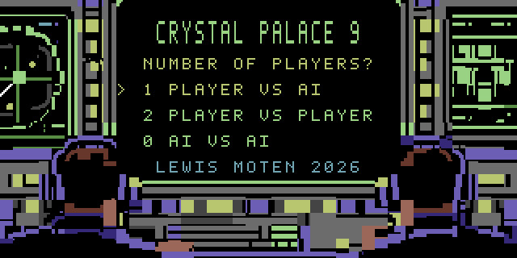</a> | **Falken-9 \| A neural network designed for the C64** Trained a mixture-of-experts tic-tac-toe model for the Commodore 64 from the start: width 8, four experts with top-2 routing and exact integer 6502 inference in a 5,195-byte model that stays in RAM. Crystal Palace 9 now plays a complete AI-vs-AI game in just over a minute, with a research report that probes the network. [Live demo](https://lewismoten.github.io/falken-9/) · [Source](https://github.com/lewismoten/falken-9) · [Hugging Face](https://huggingface.co/lewismoten/falken-9) · [Research report](https://github.com/lewismoten/falken-9/blob/main/report.md) · [More details](https://github.lewismoten.com/projects/falken-9/) |
| <a href="https://github.com/lewismoten/crystal-palace">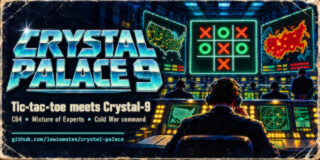</a> | **Crystal Palace 9 \| AI on 8-bit hardware** Built a Commodore 64 tic-tac-toe game whose AI moves come from a real neural network running in 6502 assembly, with a command-room interface in 8 x 8 multicolor graphics. Now powered by Falken-9, a complete AI-vs-AI game takes just over a minute, down from about 20 with the original Crystal-9 weights. [Source](https://github.com/lewismoten/crystal-palace) · [Video](https://www.youtube.com/watch?v=UJME73NxyfA) · [More details](https://github.lewismoten.com/projects/crystal-palace/) |
| <a href="https://github.com/lewismoten/palace-9">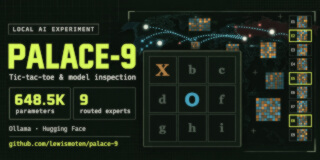</a> | **Palace-9 \| Local model inspection** A playable tic-tac-toe lab pairs a deterministic controller with a compact MoE model trained from scratch. It uses the Qwen2-MoE architecture for Ollama and llama.cpp compatibility without a custom fork; the browser inspects checkpoints locally. [Live demo](https://lewismoten.github.io/palace-9/) · [Source](https://github.com/lewismoten/palace-9) · [Ollama](https://ollama.com/lewismoten/palace-9) · [Hugging Face](https://huggingface.co/lewismoten/palace-9) · [Video](https://www.youtube.com/watch?v=J7bgpmks_KM) · [More details](https://github.lewismoten.com/projects/palace-9/) |
|  | **Zogograph Client \| AI-assisted server monitoring** PHP/SQLite collectors and a JavaScript dashboard make server telemetry, alerts, and diagnostics readable. An AI assistant calls diagnostic tools and tracks the cost of an investigation. [Source](https://github.com/lewismoten/zogograph-client) · [Videos](https://www.youtube.com/watch?v=OKndBMPknmQ&list=PLaLeerEZeFMs) · [More details](https://github.lewismoten.com/projects/zogograph-client/) |

### Embedded systems and hardware

| Project image&nbsp;&nbsp;&nbsp;&nbsp;&nbsp;&nbsp;&nbsp;&nbsp;&nbsp;&nbsp;&nbsp;&nbsp;&nbsp;&nbsp;&nbsp;&nbsp;&nbsp;&nbsp;&nbsp;&nbsp;&nbsp;&nbsp;&nbsp;&nbsp;&nbsp;&nbsp;&nbsp;&nbsp;&nbsp;&nbsp;&nbsp;&nbsp;&nbsp;&nbsp;&nbsp;&nbsp;&nbsp;&nbsp;&nbsp;&nbsp;&nbsp;&nbsp;&nbsp;&nbsp;&nbsp;&nbsp;&nbsp;&nbsp; | Project |
| :--- | :--- |
| <a href="https://github.com/lewismoten/sandbox-kernel">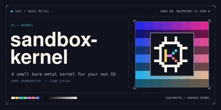</a> | **sandbox-kernel \| A small bare-metal kernel for your own OS** Built a small bare-metal kernel for the Raspberry Pi Zero W that loads your own operating system as one user-mode program from the SD card. It has A/B kernel slots with trial boot and confirm, recovery to a diagnostic program, a POSIX-style ABI, an e-ink status panel and USB development commands. Game-Maker OS is the first OS built on it. [Source](https://github.com/lewismoten/sandbox-kernel) · [The guide](https://github.com/lewismoten/sandbox-kernel/blob/develop/docs/os-authors.md) · [Game-Maker OS](https://github.com/lewismoten/gamemaker-os) · [More details](https://github.lewismoten.com/projects/sandbox-kernel/) |
| <a href="https://github.com/lewismoten/gamemaker-os">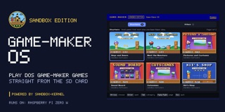</a> | **Game-Maker OS \| DOS Game-Maker games from the SD card, on a Pi Zero W** Built an operating system that turns a Raspberry Pi Zero W into a Game-Maker machine. It boots with a castle splash to a game library on a TV, with category tabs, demo previews, saves and high scores, and plays the games' original DOS files from the SD card. It runs on sandbox-kernel; an experimental QuickJS layer runs small JavaScript apps. [Source](https://github.com/lewismoten/gamemaker-os) · [sandbox-kernel](https://github.com/lewismoten/sandbox-kernel) · [More details](https://github.lewismoten.com/projects/gamemaker-os/) |
| <a href="https://github.com/lewismoten/gamemaker-pocket">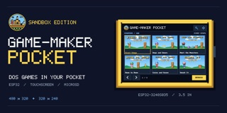</a> | **Game-Maker Pocket \| DOS games in your pocket** Built firmware that plays Game-Maker: Sandbox Edition games from their real DOS files on cheap ESP32 touch-screen boards, with a microSD library, touch and stylus controls, a settings screen and a first-start display setup. A GitHub Pages install page flashes a board from Chrome or Edge. [Web flasher](https://lewismoten.github.io/gamemaker-pocket/) · [Source](https://github.com/lewismoten/gamemaker-pocket) · [Game-Maker OS](https://github.com/lewismoten/gamemaker-os) · [More details](https://github.lewismoten.com/projects/gamemaker-pocket/) |

### Browser tools and visualization

| Project image&nbsp;&nbsp;&nbsp;&nbsp;&nbsp;&nbsp;&nbsp;&nbsp;&nbsp;&nbsp;&nbsp;&nbsp;&nbsp;&nbsp;&nbsp;&nbsp;&nbsp;&nbsp;&nbsp;&nbsp;&nbsp;&nbsp;&nbsp;&nbsp;&nbsp;&nbsp;&nbsp;&nbsp;&nbsp;&nbsp;&nbsp;&nbsp;&nbsp;&nbsp;&nbsp;&nbsp;&nbsp;&nbsp;&nbsp;&nbsp;&nbsp;&nbsp;&nbsp;&nbsp;&nbsp;&nbsp;&nbsp;&nbsp; | Project |
| :--- | :--- |
| <a href="https://github.com/lewismoten/data-over-audio">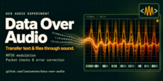</a> | **Data Over Audio \| Web Audio API** Transfers text and binary data through sound using MFSK modulation, packetization, CRC checks, Hamming error correction, interleaving, and repeat requests. [Live demo](https://lewismoten.github.io/data-over-audio/) · [Source](https://github.com/lewismoten/data-over-audio) · [Videos](https://www.youtube.com/watch?v=_6qxB3gKN_E&list=PLEyaach61fdU-OPcb5Aqgah2l6TTsaLia) · [More details](https://github.lewismoten.com/projects/data-over-audio/) |
| <a href="https://github.com/lewismoten/dial-to-eleven">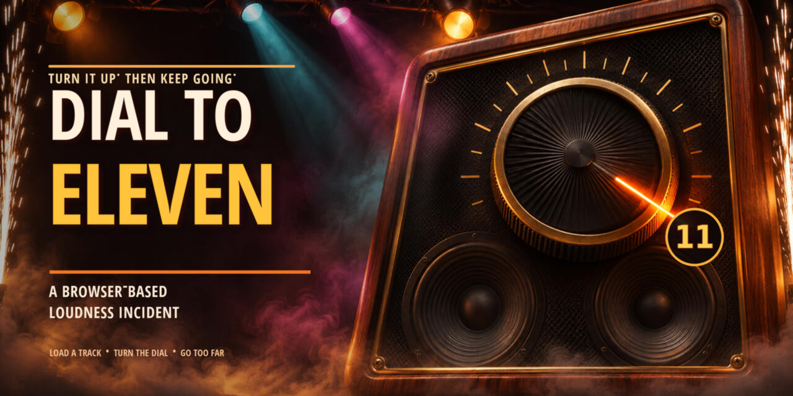</a> | **Dial to Eleven \| Browser audio amp** Built a browser-only amp for local audio files, with a rotary dial from silence to eleven. Web Audio gain, compression, and saturation drive an audio-reactive cabinet and stage show with lights, fog, fireballs, and cold sparks. The music never leaves the browser. [Live demo](https://lewismoten.github.io/dial-to-eleven/) · [Source](https://github.com/lewismoten/dial-to-eleven) · [More details](https://github.lewismoten.com/projects/dial-to-eleven/) |
| <a href="https://github.com/lewismoten/emoji">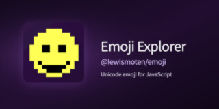</a> | **Emoji Explorer \| Unicode and pixel font** A localized Unicode explorer with version and sequence filters, favorites, keyboard navigation, and offline PWA support. Includes a custom 12 x 12 Pixel Emoji font and pixel editor. [Live demo](https://lewismoten.github.io/emoji/) · [Source](https://github.com/lewismoten/emoji) · [npm](https://www.npmjs.com/package/@lewismoten/emoji) · [More details](https://github.lewismoten.com/projects/emoji/) |
|  | **QR Code Generator \| Creator and inspector** A browser tool backed by a first-party ES module for mixed segmentation, versions 1-40, Reed-Solomon correction, mask selection, and structural inspection. [Live demo](https://qr.lewismoten.com/) · [Source](https://github.com/lewismoten/qr) · [More details](https://github.lewismoten.com/projects/qr/) |
|  | **Food Run \| Meal planning on a budget** Give it a spending limit, your kitchen equipment and how much cooking you'll do, and it suggests meals, snacks and drinks for the coming days, then builds a shopping list with an estimated total. Plain JavaScript with no build step; your data stays in your browser. [Live demo](https://lewismoten.github.io/food-run/) · [Source](https://github.com/lewismoten/food-run) · [More details](https://github.lewismoten.com/projects/food-run/) |

### Second Life

| Project image&nbsp;&nbsp;&nbsp;&nbsp;&nbsp;&nbsp;&nbsp;&nbsp;&nbsp;&nbsp;&nbsp;&nbsp;&nbsp;&nbsp;&nbsp;&nbsp;&nbsp;&nbsp;&nbsp;&nbsp;&nbsp;&nbsp;&nbsp;&nbsp;&nbsp;&nbsp;&nbsp;&nbsp;&nbsp;&nbsp;&nbsp;&nbsp;&nbsp;&nbsp;&nbsp;&nbsp;&nbsp;&nbsp;&nbsp;&nbsp;&nbsp;&nbsp;&nbsp;&nbsp;&nbsp;&nbsp;&nbsp;&nbsp; | Project |
| :--- | :--- |
| <a href="https://github.com/lewismoten/texture-mapper">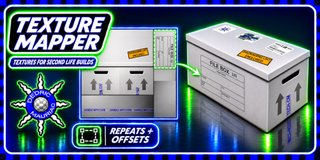</a> | **Texture Mapper \| Second Life texture repeats and offsets** Draw a box around part of a texture and read off the Second Life repeats per face and offsets, so one uploaded texture can cover many faces. A 2010 Windows tool, its C# source recovered from the published build, plus a browser version with a serial generator for the old program. [Live demo](https://lewismoten.github.io/texture-mapper/) · [Source](https://github.com/lewismoten/texture-mapper) · [More details](https://github.lewismoten.com/projects/texture-mapper/) |
| <a href="https://github.com/lewismoten/sculpted-prim-toolkit">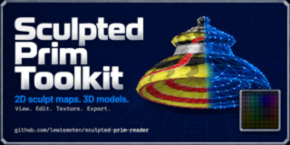</a> | **Sculpted Prim Toolkit \| Three.js editor** Decodes Second Life-style RGB sculpt maps into editable 3D geometry. Camera views, mesh overlays, textures, and vertex tools support PNG, glTF/GLB, OBJ, and STL exports. [Live demo](https://lewismoten.github.io/sculpted-prim-toolkit/) · [Source](https://github.com/lewismoten/sculpted-prim-toolkit) · [Videos](https://www.youtube.com/watch?v=egAIXJwAAHw&list=PLIyz44ZkJ3sk) · [More details](https://github.lewismoten.com/projects/sculpted-prim-toolkit/) |
| <a href="https://github.com/lewismoten/synthesized-voice-box">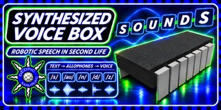</a> | **Synthesized Voice Box \| Robotic speech in Second Life** Text-to-speech inside Second Life, built by stringing together just under sixty 8-bit sounds from the General Instrument SPO256-AL2 chip. Donated as open source to Second Life's third anniversary; later versions worked around the platform's limits so speech could be understood. [Source](https://github.com/lewismoten/synthesized-voice-box) · [Video](https://youtu.be/TnB-0aerqBg) · [More details](https://github.lewismoten.com/projects/synthesized-voice-box/) |
| <a href="https://github.com/lewismoten/Eliza-Doolittle-Chatbot">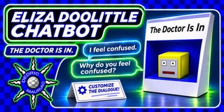</a> | **Eliza Doolittle Chatbot \| ELIZA in Linden Scripting Language** A port of Joseph Weizenbaum's 1966 ELIZA into Linden Scripting Language: a parody of a Rogerian therapist that listens to nearby residents and rephrases what they say. Given away free with full permissions, with responses in an editable notecard. [Source](https://github.com/lewismoten/Eliza-Doolittle-Chatbot) · [More details](https://github.lewismoten.com/projects/eliza-doolittle-chatbot/) |
| <a href="https://github.com/lewismoten/brain-experiment-number-two">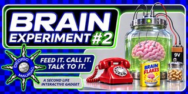</a> | **Brain Experiment #2 \| Talk to a brain in a jar** Feed and talk to a brain in a jar of liquid. Touch parts of the display for different responses, or pick up the phone to start a conversation with an ALICE chatbot through Pandorabots. [Source](https://github.com/lewismoten/brain-experiment-number-two) · [More details](https://github.lewismoten.com/projects/brain-experiment-number-two/) |
|  | **7th Son in Second Life \| A podcast player as an audio CD** A 2006 player that brought the prologue of the 7th Son audio-drama podcast into Second Life as an old CD jewel case, ten seconds of sound at a time, with play time and a progress bar in floating text. Handed out free as part of the podcast's fan missions. [Source](https://github.com/lewismoten/7th-son) · [More details](https://github.lewismoten.com/projects/7th-son/) |
| <a href="https://github.com/lewismoten/Tic-Tac-Toe-lsl">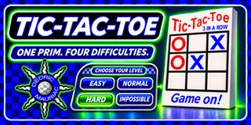</a> | **Tic-Tac-Toe \| One prim, four levels of play** Tic-tac-toe on a single Second Life prim, against an AI with four levels: easy picks a random cell; impossible always wins, blocks, forks and blocks forks. Touch the title to change the level. [Source](https://github.com/lewismoten/Tic-Tac-Toe-lsl) · [More details](https://github.lewismoten.com/projects/tic-tac-toe-lsl/) |
|  | **Password Generator \| Random passwords by instant message** A Second Life gadget that makes random passwords from 1 to 64 characters, with checkboxes for lowercase, uppercase, hex, numbers and punctuation, an option to drop look-alike characters, and presets. Passwords arrive by instant message so channel scanners cannot pick them up. [Source](https://github.com/lewismoten/Password-Generator) · [More details](https://github.lewismoten.com/projects/password-generator/) |
| <a href="https://github.com/lewismoten/Prim-Import-Export-Library">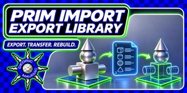</a> | **Prim Import/Export Library \| Getting objects out of Second Life** LSL scripts from 2015 that read a Second Life prim's parameters and generate code to rebuild it elsewhere, with source and destination scripts and a video of how to use them. Only for objects you made or may copy. [Source](https://github.com/lewismoten/Prim-Import-Export-Library) · [More details](https://github.lewismoten.com/projects/prim-import-export-library/) |
| <a href="https://github.com/lewismoten/Second-Life-Projects">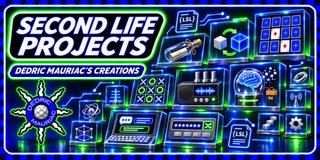</a> | **Second Life Projects \| LSL scripts as Dedric Mauriac** A collection of LSL scripts made as Dedric Mauriac: a set that copies one prim's parameters onto another (source, copier, exporter, destination and server), and a message in a bottle that gives its text to whoever touches it. [Source](https://github.com/lewismoten/Second-Life-Projects) · [More details](https://github.lewismoten.com/projects/second-life-projects/) |

### Publishing and interactive experiences

| Project image&nbsp;&nbsp;&nbsp;&nbsp;&nbsp;&nbsp;&nbsp;&nbsp;&nbsp;&nbsp;&nbsp;&nbsp;&nbsp;&nbsp;&nbsp;&nbsp;&nbsp;&nbsp;&nbsp;&nbsp;&nbsp;&nbsp;&nbsp;&nbsp;&nbsp;&nbsp;&nbsp;&nbsp;&nbsp;&nbsp;&nbsp;&nbsp;&nbsp;&nbsp;&nbsp;&nbsp;&nbsp;&nbsp;&nbsp;&nbsp;&nbsp;&nbsp;&nbsp;&nbsp;&nbsp;&nbsp;&nbsp;&nbsp; | Project |
| :--- | :--- |
| <a href="https://github.com/lewismoten/GameMaker-SandboxEdition">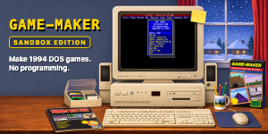</a> | **Game-Maker: Sandbox Edition \| DOS engine port and visual editors** Reimplemented and extended RSD Game-Maker 3.0 in TypeScript, preserving original DOS file formats while adding browser-based visual editors, OPL2 audio, offline play, and desktop exports. Built automated level checks and replayable walkthroughs, reusable engine and tooling packages, and original games within an interactive 1994 desktop. [Live demo](https://game-maker.games.lewismoten.com/) · [Source](https://github.com/lewismoten/GameMaker-SandboxEdition) · [Video](https://www.youtube.com/watch?v=0riemzdF8gc) · [More details](https://github.lewismoten.com/projects/gamemaker-sandbox/) |
| <a href="https://github.com/lewismoten/gamemaker-sandbox-engine">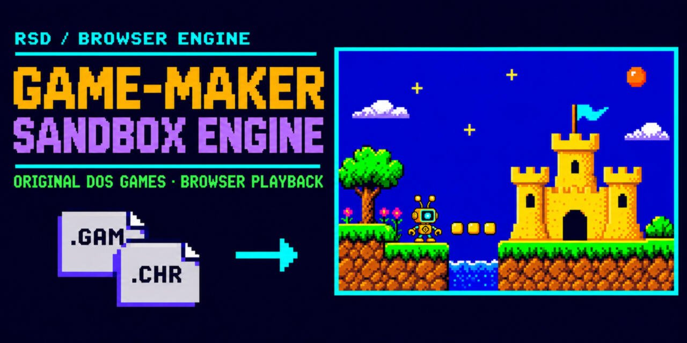</a> | **Game-Maker Sandbox Engine \| Browser engine for original DOS games** Split the Game-Maker: Sandbox Edition player engine into its own npm package. It runs RSD Game-Maker games in a browser straight from their original DOS files, with an audio worklet, TypeScript declarations, and no runtime npm dependencies. The file codecs also run in Node. [npm](https://www.npmjs.com/package/@lewismoten/gamemaker-sandbox-engine) · [Source](https://github.com/lewismoten/gamemaker-sandbox-engine) · [More details](https://github.lewismoten.com/projects/gamemaker-sandbox-engine/) |
| <a href="https://github.com/lewismoten/gamemaker-sandbox-archives">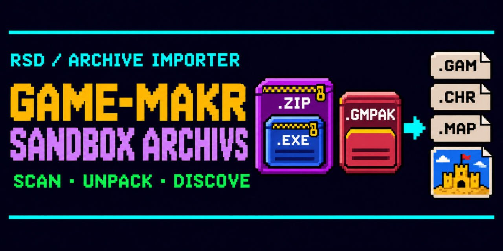</a> | **Game-Maker Sandbox Archives \| Find and unpack games in ZIPs, EXEs and packs** Split the Game-Maker: Sandbox Edition importer into its own npm package. It finds and unpacks Game-Maker games inside ZIPs, nested archives, game packs and player executables, in browsers or Node.js, reading executables as data and never running them. [npm](https://www.npmjs.com/package/@lewismoten/gamemaker-sandbox-archives) · [Source](https://github.com/lewismoten/gamemaker-sandbox-archives) · [More details](https://github.lewismoten.com/projects/gamemaker-sandbox-archives/) |
| <a href="https://github.com/lewismoten/gamemaker-sandbox-tools">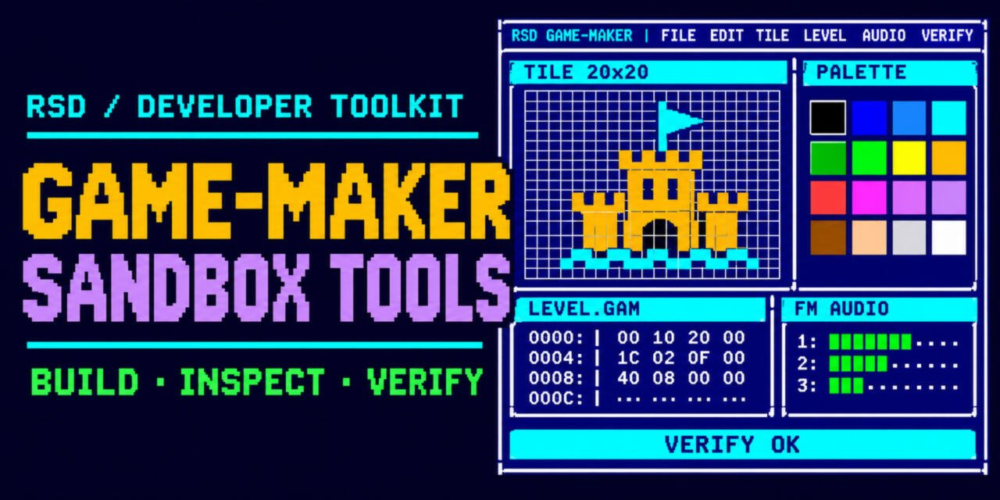</a> | **Game-Maker Sandbox Tools \| Build, inspect and verify Game-Maker data** Split the Game-Maker: Sandbox Edition build tooling into its own npm package: drawing, palettes, fonts, native file formats, music and sound, headless play simulation and ISO images, used to make and check native RSD Game-Maker data in code. [npm](https://www.npmjs.com/package/@lewismoten/gamemaker-sandbox-tools) · [Source](https://github.com/lewismoten/gamemaker-sandbox-tools) · [More details](https://github.lewismoten.com/projects/gamemaker-sandbox-tools/) |
|  | **Dreamy Tags \| WordPress plugin** An open-source PHP/Gutenberg plugin for category- and tag-filtered clouds, with exclusion rules and minimum-use thresholds. Published as a block, widget, and shortcode. [Plugin directory](https://wordpress.org/plugins/dreamy-tags/) · [Source](https://github.com/lewismoten/dreamy-tags) · [More details](https://github.lewismoten.com/projects/dreamy-tags/) |
|  | **Restoring the Signal \| Dialable exhibit** A live installation at Stone Branch Center for the Arts joins Raspberry Pi, Asterisk, and a PHP contribution site. It handles telephone audio, dialplans, transcription, and TTY support. [Live demo](https://phone.lewismoten.com/) · [Source](https://github.com/lewismoten/Phone-Exhibit) · [Videos](https://www.youtube.com/watch?v=kmOV7_2MKPg&list=PLHG0YVBnnA7k) · [Press and photos](https://www.nvdaily.com/nvdaily/dial-i-for-interactive-new-exhibit-celebrates-150-years-of-communication/article_06d37f43-5f2d-5ee3-9621-2dc1853ef4c2.html) · [More details](https://github.lewismoten.com/projects/phone-exhibit/) |
| <a href="https://github.com/lewismoten/Tiny-Pockets-Press">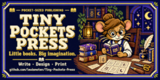</a> | **Tiny Pockets Press \| Miniature publishing** A modular JavaScript editor for miniature books, with layout and imposition logic and separate interior and cover print/PDF views. [Live demo](https://lewismoten.github.io/Tiny-Pockets-Press/#editor) · [Source](https://github.com/lewismoten/Tiny-Pockets-Press) · [Videos](https://www.youtube.com/watch?v=w9IwuwX7BkE&list=PLAgk77H8yVCA) · [More details](https://github.lewismoten.com/projects/tiny-pockets-press/) |
|  | **Shoomi's HomePage \| GeoCities restoration** A 1990s web restoration with a Canvas recreation of its Java applet marquee, Web Audio MIDI playback, and a browser version of a Visual Basic color editor. [Live demo](https://lewismoten.github.io/Athens-Acropolis-4507/) · [Source](https://github.com/lewismoten/Athens-Acropolis-4507) · [Videos](https://www.youtube.com/watch?v=UgJgb0VUaHw&list=PLI4A73VhrZT4) · [More details](https://github.lewismoten.com/projects/athens-acropolis/) |

### Media preservation and recovery

| Project image&nbsp;&nbsp;&nbsp;&nbsp;&nbsp;&nbsp;&nbsp;&nbsp;&nbsp;&nbsp;&nbsp;&nbsp;&nbsp;&nbsp;&nbsp;&nbsp;&nbsp;&nbsp;&nbsp;&nbsp;&nbsp;&nbsp;&nbsp;&nbsp;&nbsp;&nbsp;&nbsp;&nbsp;&nbsp;&nbsp;&nbsp;&nbsp;&nbsp;&nbsp;&nbsp;&nbsp;&nbsp;&nbsp;&nbsp;&nbsp;&nbsp;&nbsp;&nbsp;&nbsp;&nbsp;&nbsp;&nbsp;&nbsp; | Project |
| :--- | :--- |
| <a href="https://github.com/lewismoten/provo-craft-cd-recovery">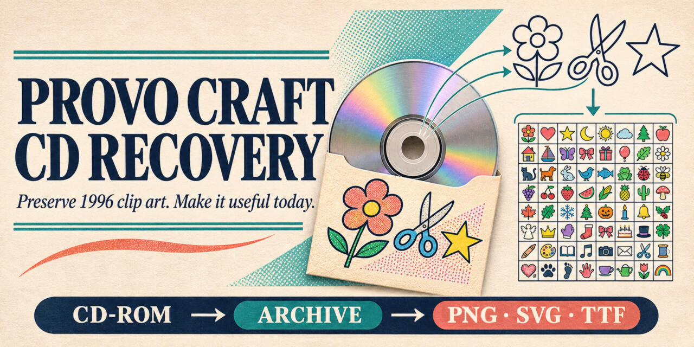</a> | **Provo Craft CD Recovery \| Preserving 1996 clip-art CD-ROMs** Built a macOS recovery workflow for classic HFS Provo Craft clip-art CD-ROMs that modern macOS cannot read. It preserves raw disc images, extracts artwork and Mac suitcase fonts, creates PNG and SVG derivatives locally, and documents the restrictive original license while keeping recovered media out of Git. [Source](https://github.com/lewismoten/provo-craft-cd-recovery) · [More details](https://github.lewismoten.com/projects/provo-craft-cd-recovery/) |

### 8-bit retro Commodore 64 projects

| Project image&nbsp;&nbsp;&nbsp;&nbsp;&nbsp;&nbsp;&nbsp;&nbsp;&nbsp;&nbsp;&nbsp;&nbsp;&nbsp;&nbsp;&nbsp;&nbsp;&nbsp;&nbsp;&nbsp;&nbsp;&nbsp;&nbsp;&nbsp;&nbsp;&nbsp;&nbsp;&nbsp;&nbsp;&nbsp;&nbsp;&nbsp;&nbsp;&nbsp;&nbsp;&nbsp;&nbsp;&nbsp;&nbsp;&nbsp;&nbsp;&nbsp;&nbsp;&nbsp;&nbsp;&nbsp;&nbsp;&nbsp;&nbsp; | Project |
| :--- | :--- |
| <a href="https://github.com/lewismoten/storage-d64">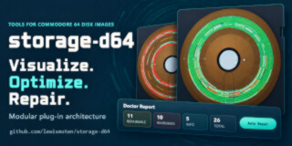</a> | **D64 Storage Lab \| Repair and optimization** A JavaScript workbench maps Commodore 64 disk sectors and file chains, estimates read efficiency, repairs corruption, restores deleted files, and compares optimized and fragmented layouts. [Live demo](https://lewismoten.github.io/storage-d64/) · [Source](https://github.com/lewismoten/storage-d64) · [Video](https://www.youtube.com/watch?v=cXeIy4AZewY) · [More details](https://github.lewismoten.com/projects/storage-d64/) |
| <a href="https://github.com/lewismoten/sector-256">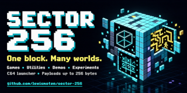</a> | **Sector 256 \| Tiny programs for the C64** Built a graphical Commodore 64 launcher for games, utilities, demos, and experiments with stored payloads of 256 bytes or less. Combines 6502 assembly, shared routines, and a Python build pipeline to package programs into a D64 disk image, with automated machine-code tests. [Live demo](https://lewismoten.github.io/sector-256/) · [Source](https://github.com/lewismoten/sector-256) · [Video](https://www.youtube.com/watch?v=dptHv4-RSWo) · [More details](https://github.lewismoten.com/projects/sector-256/) |

### Government Transparency

| Project image&nbsp;&nbsp;&nbsp;&nbsp;&nbsp;&nbsp;&nbsp;&nbsp;&nbsp;&nbsp;&nbsp;&nbsp;&nbsp;&nbsp;&nbsp;&nbsp;&nbsp;&nbsp;&nbsp;&nbsp;&nbsp;&nbsp;&nbsp;&nbsp;&nbsp;&nbsp;&nbsp;&nbsp;&nbsp;&nbsp;&nbsp;&nbsp;&nbsp;&nbsp;&nbsp;&nbsp;&nbsp;&nbsp;&nbsp;&nbsp;&nbsp;&nbsp;&nbsp;&nbsp;&nbsp;&nbsp;&nbsp;&nbsp; | Project |
| :--- | :--- |
|  | **Stream Scribe \| Independent meeting archive and research** Developing an independent archive and research tool for livestreamed government meetings. Captures video, transcribes locally with Whisper, and supports searching transcripts and navigating thumbnails while meetings are still live. Adds speaker, topic, and vote annotations, exports short clips, and fills capture gaps from official recordings. Built with React, TypeScript, Node.js, and SQLite. [Source](https://github.com/lewismoten/streamscribe) · [More details](https://github.lewismoten.com/projects/stream-scribe/) |
<!-- PROJECTS:END -->

## Beyond code

I volunteer with local history and library projects, started a LEGO users group, and sometimes perform as a clown. I like projects that connect technology with something people can actually use, explore, or enjoy.

| Site&nbsp;&nbsp;&nbsp;&nbsp;&nbsp;&nbsp;&nbsp;&nbsp;&nbsp;&nbsp;&nbsp;&nbsp;&nbsp;&nbsp;&nbsp;&nbsp;&nbsp;&nbsp;&nbsp;&nbsp;&nbsp;&nbsp;&nbsp;&nbsp;&nbsp;&nbsp;&nbsp;&nbsp;&nbsp;&nbsp;&nbsp;&nbsp;&nbsp;&nbsp;&nbsp;&nbsp;&nbsp;&nbsp;&nbsp;&nbsp;&nbsp;&nbsp;&nbsp;&nbsp;&nbsp;&nbsp;&nbsp;&nbsp;&nbsp;&nbsp;&nbsp;&nbsp;&nbsp;&nbsp;&nbsp;&nbsp;&nbsp;&nbsp;&nbsp;&nbsp;&nbsp;&nbsp;&nbsp;&nbsp; | About |
| :--- | :--- |
| <a href="https://lewismoten.com/">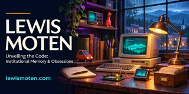</a> | **lewismoten.com \| Blog and career history** A near-daily blog about the projects on this page and the history behind them. [Blog](https://lewismoten.com/blog/) · [Career history](https://lewismoten.com/employment/) |
| <a href="https://thebardofbizarre.com/">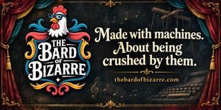</a> | **The Bard of Bizarre \| Lyrics, music and visuals** A multimedia project built around my lyrics and a 16-track concept album with AI-generated music and visuals. [Website](https://thebardofbizarre.com/) · [Listen on Spotify and other services](https://distrokid.com/hyperfollow/thebardofbizarre/re-cubicle-13) · [Watch “Time Is a Flat Liar”](https://distrokid.com/videos/watch/dv-L9yj4VzE2) |
| <a href="https://frontroyallug.wordpress.com/">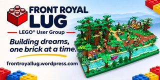</a> | **Front Royal LUG \| LEGO User Group** The LEGO users group I started and organize in Front Royal. [Website](https://frontroyallug.wordpress.com/) |
|  | **The Chez \| A 1976½ CitiCar** Restoring, upgrading and driving my 1976½ Sebring-Vanguard CitiCar, an early electric car. [Blog](https://thechez.car.blog/) |

[Code Jamboree LLC](https://www.codejamboree.com/) · [Schedule a conversation](https://calendly.com/lewismoten)
