# Lewis Moten

**Senior front-end engineer | React, TypeScript, and applied AI**

I turn complex data and workflows into usable web applications. I've programmed professionally since 1997, and my recent work spans interactive front ends, small local AI models, browser tools, and the infrastructure that runs them. I'm based in Front Royal, Virginia and interested in senior front-end engineering and AI application roles.

[Portfolio site](https://lewismoten.github.io/) · [Career history](https://lewismoten.com/employment/) · [Blog](https://lewismoten.com/blog/) · [Email](mailto:lewismoten@gmail.com) · [LinkedIn](https://www.linkedin.com/in/lewismoten/)

**Career documents:** [Introduction letter (PDF)](./resume/current/intro-letter-for-lewis-moten.pdf) · [Resume (PDF)](./resume/current/resume-for-lewis-moten.pdf) · [Selected projects (PDF)](./resume/current/selected-projects-for-lewis-moten.pdf)

## Start here

- **React and TypeScript:** [Public-ledger explorer](https://github.com/lewismoten/wcfac-general-ledger) — filtering and visualizing public financial data.
- **Applied AI:** [Crystal-9](https://github.com/lewismoten/crystal-9) — a compact, validated MoE model built for tight memory limits.
- **Server operations:** [Zogograph Client](https://github.com/lewismoten/zogograph-client) — telemetry, alerts, and AI-assisted diagnostics with cost tracking.
- **Interactive tools:** [D64 Storage Lab](https://lewismoten.github.io/storage-d64/) — visual disk repair, recovery, and read-efficiency experiments.

## What I work with

- **Front end:** React, TypeScript, JavaScript, accessible interfaces, data visualization, and browser APIs.
- **Applied AI:** PyTorch, model training and validation, MoE architectures, Ollama, llama.cpp, local inference, and tool calling.
- **Services and delivery:** Node.js, PHP, C#/.NET, SQLite and SQL, Linux hosting, Forgejo, CI/CD, and WHM/cPanel automation. 

## Projects

Each project's **More details** page on [my portfolio site](https://lewismoten.github.io/projects/) has an executive summary and a technical overview. Palace-9, Crystal-9, Crystal Palace 9 and Falken-9 are one series, compared side by side in [The tic-tac-toe models](https://lewismoten.github.io/series/tic-tac-toe-models/).

<!-- PROJECTS:START -->
### Applied AI and model engineering

| Project image&nbsp;&nbsp;&nbsp;&nbsp;&nbsp;&nbsp;&nbsp;&nbsp;&nbsp;&nbsp;&nbsp;&nbsp;&nbsp;&nbsp;&nbsp;&nbsp;&nbsp;&nbsp;&nbsp;&nbsp;&nbsp;&nbsp;&nbsp;&nbsp;&nbsp;&nbsp;&nbsp;&nbsp;&nbsp;&nbsp;&nbsp;&nbsp;&nbsp;&nbsp;&nbsp;&nbsp;&nbsp;&nbsp;&nbsp;&nbsp;&nbsp;&nbsp;&nbsp;&nbsp;&nbsp;&nbsp;&nbsp;&nbsp; | Project |
| :--- | :--- |
|  | **Local Agent Lab \| Portable AI workspace** Built a private React and TypeScript AI workspace for chat, code, images, and audio. Runs models in the browser or on a local Ollama server, so it works offline and conversations never have to leave the device; API providers are optional. Projects stay in a folder or on a removable drive. [Live demo](https://lewismoten.github.io/local-agent-lab/) · [Source](https://github.com/lewismoten/local-agent-lab) · [More details](https://lewismoten.github.io/projects/local-agent-lab/) |
| <a href="https://github.com/lewismoten/ghostjack">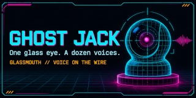</a> | **Ghost Jack \| Eyes, ears and a mouth for AI agents** Built a local bridge and cyberpunk control deck that gives people and AI agents eyes, ears and a mouth through a $2 thrift-store pan/tilt camera, with no cloud app. Reverse-engineered its sign-in, live RTSP stream, pan/tilt, night vision and speaker (found through the vendor's old Flash engine), with recording and a three.js aiming model. [Live demo](https://lewismoten.github.io/ghostjack/) · [Source](https://github.com/lewismoten/ghostjack) · [More details](https://lewismoten.github.io/projects/ghostjack/) |
| <a href="https://github.com/lewismoten/crystal-9">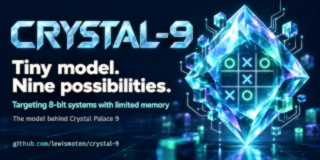</a> | **Crystal-9 \| Tiny MoE for 8-bit hardware** Redesigned a sparse MoE tic-tac-toe policy for a 13-token vocabulary and tight memory budgets. Released a 46,299-byte packed INT4 artifact for a custom local runtime, with zero policy misses across 294,778 legal histories. A compact adaptation powers Crystal Palace 9 on the C64. [Source](https://github.com/lewismoten/crystal-9) · [Hugging Face](https://huggingface.co/lewismoten/crystal-9) · [More details](https://lewismoten.github.io/projects/crystal-9/) |
| <a href="https://github.com/lewismoten/falken-9">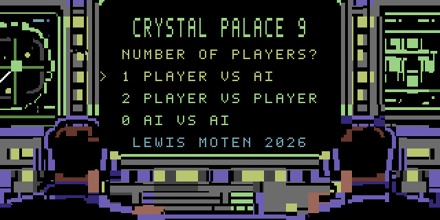</a> | **Falken-9 \| A neural network designed for the C64** Trained a mixture-of-experts tic-tac-toe model for the Commodore 64 from the start: width 8, four experts with top-2 routing and exact integer 6502 inference in a 5,195-byte model that stays in RAM. Crystal Palace 9 now plays a complete AI-vs-AI game in just over a minute, with a research report that probes the network. [Live demo](https://lewismoten.github.io/falken-9/) · [Source](https://github.com/lewismoten/falken-9) · [Hugging Face](https://huggingface.co/lewismoten/falken-9) · [Research report](https://github.com/lewismoten/falken-9/blob/main/report.md) · [More details](https://lewismoten.github.io/projects/falken-9/) |
| <a href="https://github.com/lewismoten/crystal-palace">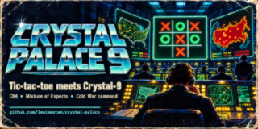</a> | **Crystal Palace 9 \| AI on 8-bit hardware** Built a Commodore 64 tic-tac-toe game whose AI moves come from a real neural network running in 6502 assembly, with a command-room interface in 8 x 8 multicolor graphics. Now powered by Falken-9, a complete AI-vs-AI game takes just over a minute, down from about 20 with the original Crystal-9 weights. [Source](https://github.com/lewismoten/crystal-palace) · [Video](https://www.youtube.com/watch?v=UJME73NxyfA) · [More details](https://lewismoten.github.io/projects/crystal-palace/) |
|  | **Palace-9 \| Local model inspection** A playable tic-tac-toe lab pairs a deterministic controller with a compact MoE model trained from scratch. It uses the Qwen2-MoE architecture for Ollama and llama.cpp compatibility without a custom fork; the browser inspects checkpoints locally. [Live demo](https://lewismoten.github.io/palace-9/) · [Source](https://github.com/lewismoten/palace-9) · [Ollama](https://ollama.com/lewismoten/palace-9) · [Hugging Face](https://huggingface.co/lewismoten/palace-9) · [Video](https://www.youtube.com/watch?v=J7bgpmks_KM) · [More details](https://lewismoten.github.io/projects/palace-9/) |
|  | **Zogograph Client \| AI-assisted server monitoring** PHP/SQLite collectors and a JavaScript dashboard make server telemetry, alerts, and diagnostics readable. An AI assistant calls diagnostic tools and tracks the cost of an investigation. [Source](https://github.com/lewismoten/zogograph-client) · [Videos](https://www.youtube.com/watch?v=OKndBMPknmQ&list=PLaLeerEZeFMs) · [More details](https://lewismoten.github.io/projects/zogograph-client/) |

### Embedded systems and hardware

| Project image&nbsp;&nbsp;&nbsp;&nbsp;&nbsp;&nbsp;&nbsp;&nbsp;&nbsp;&nbsp;&nbsp;&nbsp;&nbsp;&nbsp;&nbsp;&nbsp;&nbsp;&nbsp;&nbsp;&nbsp;&nbsp;&nbsp;&nbsp;&nbsp;&nbsp;&nbsp;&nbsp;&nbsp;&nbsp;&nbsp;&nbsp;&nbsp;&nbsp;&nbsp;&nbsp;&nbsp;&nbsp;&nbsp;&nbsp;&nbsp;&nbsp;&nbsp;&nbsp;&nbsp;&nbsp;&nbsp;&nbsp;&nbsp; | Project |
| :--- | :--- |
| <a href="https://github.com/lewismoten/sandbox-kernel">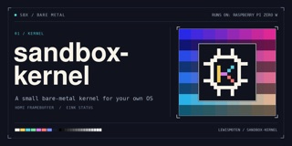</a> | **sandbox-kernel \| A small bare-metal kernel for your own OS** Built a small bare-metal kernel for the Raspberry Pi Zero W that loads your own operating system as one user-mode program from the SD card. It has A/B kernel slots with trial boot and confirm, recovery to a diagnostic program, a POSIX-style ABI, an e-ink status panel and USB development commands. Game-Maker OS is the first OS built on it. [Source](https://github.com/lewismoten/sandbox-kernel) · [The guide](https://github.com/lewismoten/sandbox-kernel/blob/develop/docs/os-authors.md) · [Game-Maker OS](https://github.com/lewismoten/gamemaker-os) · [More details](https://lewismoten.github.io/projects/sandbox-kernel/) |
| <a href="https://github.com/lewismoten/gamemaker-os">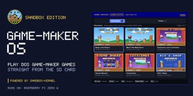</a> | **Game-Maker OS \| DOS Game-Maker games from the SD card, on a Pi Zero W** Built an operating system that turns a Raspberry Pi Zero W into a Game-Maker machine. It boots with a castle splash to a game library on a TV, with category tabs, demo previews, saves and high scores, and plays the games' original DOS files from the SD card. It runs on sandbox-kernel; an experimental QuickJS layer runs small JavaScript apps. [Source](https://github.com/lewismoten/gamemaker-os) · [sandbox-kernel](https://github.com/lewismoten/sandbox-kernel) · [More details](https://lewismoten.github.io/projects/gamemaker-os/) |
| <a href="https://github.com/lewismoten/gamemaker-pocket">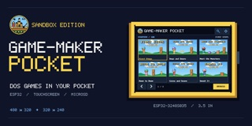</a> | **Game-Maker Pocket \| DOS games in your pocket** Built firmware that plays Game-Maker: Sandbox Edition games from their real DOS files on cheap ESP32 touch-screen boards, with a microSD library, touch and stylus controls, a settings screen and a first-start display setup. A GitHub Pages install page flashes a board from Chrome or Edge. [Web flasher](https://lewismoten.github.io/gamemaker-pocket/) · [Source](https://github.com/lewismoten/gamemaker-pocket) · [Game-Maker OS](https://github.com/lewismoten/gamemaker-os) · [More details](https://lewismoten.github.io/projects/gamemaker-pocket/) |

### Browser tools and visualization

| Project image&nbsp;&nbsp;&nbsp;&nbsp;&nbsp;&nbsp;&nbsp;&nbsp;&nbsp;&nbsp;&nbsp;&nbsp;&nbsp;&nbsp;&nbsp;&nbsp;&nbsp;&nbsp;&nbsp;&nbsp;&nbsp;&nbsp;&nbsp;&nbsp;&nbsp;&nbsp;&nbsp;&nbsp;&nbsp;&nbsp;&nbsp;&nbsp;&nbsp;&nbsp;&nbsp;&nbsp;&nbsp;&nbsp;&nbsp;&nbsp;&nbsp;&nbsp;&nbsp;&nbsp;&nbsp;&nbsp;&nbsp;&nbsp; | Project |
| :--- | :--- |
| <a href="https://github.com/lewismoten/sculpted-prim-toolkit">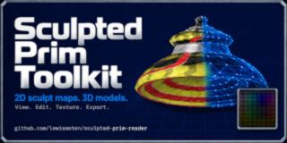</a> | **Sculpted Prim Toolkit \| Three.js editor** Decodes Second Life-style RGB sculpt maps into editable 3D geometry. Camera views, mesh overlays, textures, and vertex tools support PNG, glTF/GLB, OBJ, and STL exports. [Live demo](https://lewismoten.github.io/sculpted-prim-toolkit/) · [Source](https://github.com/lewismoten/sculpted-prim-toolkit) · [Videos](https://www.youtube.com/watch?v=egAIXJwAAHw&list=PLIyz44ZkJ3sk) · [More details](https://lewismoten.github.io/projects/sculpted-prim-toolkit/) |
| <a href="https://github.com/lewismoten/data-over-audio">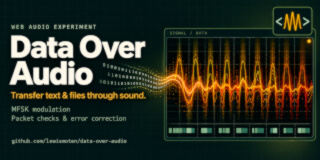</a> | **Data Over Audio \| Web Audio API** Transfers text and binary data through sound using MFSK modulation, packetization, CRC checks, Hamming error correction, interleaving, and repeat requests. [Live demo](https://lewismoten.github.io/data-over-audio/) · [Source](https://github.com/lewismoten/data-over-audio) · [Videos](https://www.youtube.com/watch?v=_6qxB3gKN_E&list=PLEyaach61fdU-OPcb5Aqgah2l6TTsaLia) · [More details](https://lewismoten.github.io/projects/data-over-audio/) |
| <a href="https://github.com/lewismoten/emoji">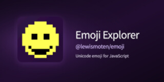</a> | **Emoji Explorer \| Unicode and pixel font** A localized Unicode explorer with version and sequence filters, favorites, keyboard navigation, and offline PWA support. Includes a custom 12 x 12 Pixel Emoji font and pixel editor. [Live demo](https://lewismoten.github.io/emoji/) · [Source](https://github.com/lewismoten/emoji) · [npm](https://www.npmjs.com/package/@lewismoten/emoji) · [More details](https://lewismoten.github.io/projects/emoji/) |
|  | **QR Code Generator \| Creator and inspector** A browser tool backed by a first-party ES module for mixed segmentation, versions 1-40, Reed-Solomon correction, mask selection, and structural inspection. [Live demo](https://qr.lewismoten.com/) · [Source](https://github.com/lewismoten/qr) · [More details](https://lewismoten.github.io/projects/qr/) |

### Publishing and interactive experiences

| Project image&nbsp;&nbsp;&nbsp;&nbsp;&nbsp;&nbsp;&nbsp;&nbsp;&nbsp;&nbsp;&nbsp;&nbsp;&nbsp;&nbsp;&nbsp;&nbsp;&nbsp;&nbsp;&nbsp;&nbsp;&nbsp;&nbsp;&nbsp;&nbsp;&nbsp;&nbsp;&nbsp;&nbsp;&nbsp;&nbsp;&nbsp;&nbsp;&nbsp;&nbsp;&nbsp;&nbsp;&nbsp;&nbsp;&nbsp;&nbsp;&nbsp;&nbsp;&nbsp;&nbsp;&nbsp;&nbsp;&nbsp;&nbsp; | Project |
| :--- | :--- |
| <a href="https://github.com/lewismoten/GameMaker-SandboxEdition">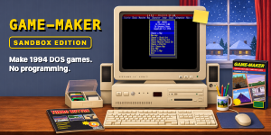</a> | **Game-Maker: Sandbox Edition \| DOS engine port and visual editors** Reimplemented and extended RSD Game-Maker 3.0 in TypeScript, preserving original DOS file formats while adding browser-based visual editors, OPL2 audio, offline play, and desktop exports. Built automated level checks and replayable walkthroughs, reusable engine and tooling packages, and original games within an interactive 1994 desktop. [Live demo](https://lewismoten.github.io/GameMaker-SandboxEdition/) · [Source](https://github.com/lewismoten/GameMaker-SandboxEdition) · [Video](https://www.youtube.com/watch?v=0riemzdF8gc) · [More details](https://lewismoten.github.io/projects/gamemaker-sandbox/) |
|  | **Dreamy Tags \| WordPress plugin** An open-source PHP/Gutenberg plugin for category- and tag-filtered clouds, with exclusion rules and minimum-use thresholds. Published as a block, widget, and shortcode. [Plugin directory](https://wordpress.org/plugins/dreamy-tags/) · [Source](https://github.com/lewismoten/dreamy-tags) · [More details](https://lewismoten.github.io/projects/dreamy-tags/) |
|  | **Restoring the Signal \| Dialable exhibit** A live installation at Stone Branch Center for the Arts joins Raspberry Pi, Asterisk, and a PHP contribution site. It handles telephone audio, dialplans, transcription, and TTY support. [Live demo](https://phone.lewismoten.com/) · [Source](https://github.com/lewismoten/Phone-Exhibit) · [Videos](https://www.youtube.com/watch?v=kmOV7_2MKPg&list=PLHG0YVBnnA7k) · [Press and photos](https://www.nvdaily.com/nvdaily/dial-i-for-interactive-new-exhibit-celebrates-150-years-of-communication/article_06d37f43-5f2d-5ee3-9621-2dc1853ef4c2.html) · [More details](https://lewismoten.github.io/projects/phone-exhibit/) |
| <a href="https://github.com/lewismoten/Tiny-Pockets-Press">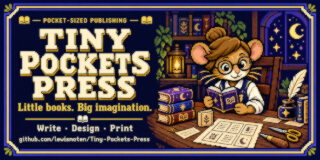</a> | **Tiny Pockets Press \| Miniature publishing** A modular JavaScript editor for miniature books, with layout and imposition logic and separate interior and cover print/PDF views. [Live demo](https://lewismoten.github.io/Tiny-Pockets-Press/#editor) · [Source](https://github.com/lewismoten/Tiny-Pockets-Press) · [Videos](https://www.youtube.com/watch?v=w9IwuwX7BkE&list=PLAgk77H8yVCA) · [More details](https://lewismoten.github.io/projects/tiny-pockets-press/) |
|  | **Shoomi's HomePage \| GeoCities restoration** A 1990s web restoration with a Canvas recreation of its Java applet marquee, Web Audio MIDI playback, and a browser version of a Visual Basic color editor. [Live demo](https://lewismoten.github.io/Athens-Acropolis-4507/) · [Source](https://github.com/lewismoten/Athens-Acropolis-4507) · [Videos](https://www.youtube.com/watch?v=UgJgb0VUaHw&list=PLI4A73VhrZT4) · [More details](https://lewismoten.github.io/projects/athens-acropolis/) |

### 8-bit retro Commodore 64 projects

| Project image&nbsp;&nbsp;&nbsp;&nbsp;&nbsp;&nbsp;&nbsp;&nbsp;&nbsp;&nbsp;&nbsp;&nbsp;&nbsp;&nbsp;&nbsp;&nbsp;&nbsp;&nbsp;&nbsp;&nbsp;&nbsp;&nbsp;&nbsp;&nbsp;&nbsp;&nbsp;&nbsp;&nbsp;&nbsp;&nbsp;&nbsp;&nbsp;&nbsp;&nbsp;&nbsp;&nbsp;&nbsp;&nbsp;&nbsp;&nbsp;&nbsp;&nbsp;&nbsp;&nbsp;&nbsp;&nbsp;&nbsp;&nbsp; | Project |
| :--- | :--- |
|  | **D64 Storage Lab \| Repair and optimization** A JavaScript workbench maps Commodore 64 disk sectors and file chains, estimates read efficiency, repairs corruption, restores deleted files, and compares optimized and fragmented layouts. [Live demo](https://lewismoten.github.io/storage-d64/) · [Source](https://github.com/lewismoten/storage-d64) · [Video](https://www.youtube.com/watch?v=cXeIy4AZewY) · [More details](https://lewismoten.github.io/projects/storage-d64/) |
| <a href="https://github.com/lewismoten/sector-256">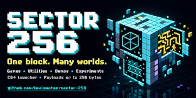</a> | **Sector 256 \| Tiny programs for the C64** Built a graphical Commodore 64 launcher for games, utilities, demos, and experiments with stored payloads of 256 bytes or less. Combines 6502 assembly, shared routines, and a Python build pipeline to package programs into a D64 disk image, with automated machine-code tests. [Live demo](https://lewismoten.github.io/sector-256/) · [Source](https://github.com/lewismoten/sector-256) · [Video](https://www.youtube.com/watch?v=dptHv4-RSWo) · [More details](https://lewismoten.github.io/projects/sector-256/) |

### Government Transparency

| Project image&nbsp;&nbsp;&nbsp;&nbsp;&nbsp;&nbsp;&nbsp;&nbsp;&nbsp;&nbsp;&nbsp;&nbsp;&nbsp;&nbsp;&nbsp;&nbsp;&nbsp;&nbsp;&nbsp;&nbsp;&nbsp;&nbsp;&nbsp;&nbsp;&nbsp;&nbsp;&nbsp;&nbsp;&nbsp;&nbsp;&nbsp;&nbsp;&nbsp;&nbsp;&nbsp;&nbsp;&nbsp;&nbsp;&nbsp;&nbsp;&nbsp;&nbsp;&nbsp;&nbsp;&nbsp;&nbsp;&nbsp;&nbsp; | Project |
| :--- | :--- |
|  | **Stream Scribe \| Independent meeting archive and research** Developing an independent archive and research tool for livestreamed government meetings. Captures video, transcribes locally with Whisper, and supports searching transcripts and navigating thumbnails while meetings are still live. Adds speaker, topic, and vote annotations, exports short clips, and fills capture gaps from official recordings. Built with React, TypeScript, Node.js, and SQLite. [Source](https://github.com/lewismoten/streamscribe) · [More details](https://lewismoten.github.io/projects/stream-scribe/) |
<!-- PROJECTS:END -->

## Beyond code

I volunteer with local history and library projects, started a LEGO users group, and sometimes perform as a clown. I like projects that connect technology with something people can actually use, explore, or enjoy.

| Site&nbsp;&nbsp;&nbsp;&nbsp;&nbsp;&nbsp;&nbsp;&nbsp;&nbsp;&nbsp;&nbsp;&nbsp;&nbsp;&nbsp;&nbsp;&nbsp;&nbsp;&nbsp;&nbsp;&nbsp;&nbsp;&nbsp;&nbsp;&nbsp;&nbsp;&nbsp;&nbsp;&nbsp;&nbsp;&nbsp;&nbsp;&nbsp;&nbsp;&nbsp;&nbsp;&nbsp;&nbsp;&nbsp;&nbsp;&nbsp;&nbsp;&nbsp;&nbsp;&nbsp;&nbsp;&nbsp;&nbsp;&nbsp; | About |
| :--- | :--- |
| <a href="https://lewismoten.com/">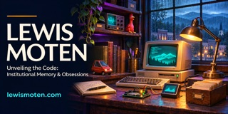</a> | **lewismoten.com \| Blog and career history** A near-daily blog about the projects on this page and the history behind them. [Blog](https://lewismoten.com/blog/) · [Career history](https://lewismoten.com/employment/) |
| <a href="https://thebardofbizarre.com/">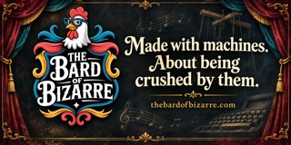</a> | **The Bard of Bizarre \| Lyrics, music and visuals** A multimedia project built around my lyrics and a 16-track concept album with AI-generated music and visuals. [Website](https://thebardofbizarre.com/) · [Listen on Spotify and other services](https://distrokid.com/hyperfollow/thebardofbizarre/re-cubicle-13) · [Watch “Time Is a Flat Liar”](https://distrokid.com/videos/watch/dv-L9yj4VzE2) |
|  | **The Chez \| A 1976½ CitiCar** Restoring, upgrading and driving my 1976½ Sebring-Vanguard CitiCar, an early electric car. [Blog](https://thechez.car.blog/) |

[Code Jamboree LLC](https://www.codejamboree.com/) · [Schedule a conversation](https://calendly.com/lewismoten)
