# Lewis Moten

[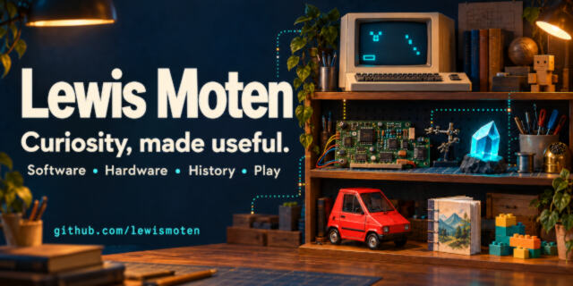](https://lewismoten.github.io)

**Senior front-end engineer | React, TypeScript, and applied AI**

I turn complex data and workflows into usable web applications. I've programmed professionally since 1997, and my recent work spans interactive front ends, small local AI models, browser tools, and the infrastructure that runs them. I have led development teams and brought development builds down from 20 minutes to 2.

I'm based in Front Royal, Virginia and interested in senior front-end engineering and AI application roles.

[Portfolio site](https://lewismoten.github.io) · [Career history](https://lewismoten.com/employment/) · [Blog](https://lewismoten.com/blog/) · [Email](mailto:lewismoten@gmail.com) · [LinkedIn](https://www.linkedin.com/in/lewismoten/)

**Career documents:** [Introduction letter (PDF)](https://github.com/lewismoten/lewismoten/raw/main/resume/current/intro-letter-for-lewis-moten.pdf) · [Resume (PDF)](https://github.com/lewismoten/lewismoten/raw/main/resume/current/resume-for-lewis-moten.pdf) · [Selected projects (PDF)](https://github.com/lewismoten/lewismoten/raw/main/resume/current/selected-projects-for-lewis-moten.pdf)

## Start here

- **React and TypeScript:** [Public-ledger explorer](https://github.com/lewismoten/wcfac-general-ledger) — filtering and visualizing public financial data.
- **Applied AI:** [Crystal-9](https://lewismoten.github.io/projects/crystal-9/) — a compact, validated MoE model built for tight memory limits.
- **Server operations:** [Zogograph Client](https://lewismoten.github.io/projects/zogograph-client/) — telemetry, alerts, and AI-assisted diagnostics with cost tracking.
- **Interactive tools:** [D64 Storage Lab](https://lewismoten.github.io/projects/storage-d64/) — visual disk repair, recovery, and read-efficiency experiments.

## What I work with

- **Front end:** React, TypeScript, JavaScript, accessible interfaces, data visualization, and browser APIs.
- **Applied AI:** PyTorch, model training and validation, MoE architectures, Ollama, llama.cpp, local inference, and tool calling.
- **Services and delivery:** Node.js, PHP, C#/.NET, SQLite and SQL, Linux hosting, Forgejo, CI/CD, and WHM/cPanel automation.

## Projects

Each project has a longer case study on [the portfolio site](https://lewismoten.github.io/projects/).

### Applied AI and model engineering

| Project image | Project |
| :--- | :--- |
|  | **Local Agent Lab \| Portable AI workspace** A React and TypeScript browser workspace for coding, research, and scheduled agents that runs small models locally and keeps projects on a folder or removable drive. [Live demo](https://lewismoten.github.io/local-agent-lab/) · [Source](https://github.com/lewismoten/local-agent-lab) · [Case study](https://lewismoten.github.io/projects/local-agent-lab/) |
| [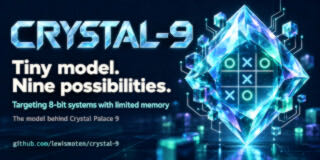](https://lewismoten.github.io/projects/crystal-9/) | **Crystal-9 \| Tiny MoE for 8-bit hardware** A compact, validated mixture-of-experts tic-tac-toe policy model: a 46,299-byte packed INT4 artifact with zero policy misses across 294,778 legal histories. [Source](https://github.com/lewismoten/crystal-9) · [Hugging Face](https://huggingface.co/lewismoten/crystal-9) · [Case study](https://lewismoten.github.io/projects/crystal-9/) |
|  | **Crystal Palace 9 \| AI on 8-bit hardware** A Commodore 64 tic-tac-toe project built around the original Crystal-9 packed INT4 weights, run from a 1541 disk. [Source](https://github.com/lewismoten/crystal-palace) · [Video](https://www.youtube.com/watch?v=UJME73NxyfA) · [Case study](https://lewismoten.github.io/projects/crystal-palace/) |
| [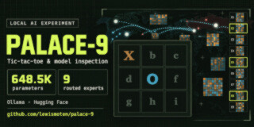](https://lewismoten.github.io/projects/palace-9/) | **Palace-9 \| Local model inspection** A playable tic-tac-toe lab that pairs a deterministic controller with a compact MoE model trained from scratch, and a browser inspector that reads the checkpoint locally. [Live demo](https://lewismoten.github.io/palace-9/) · [Source](https://github.com/lewismoten/palace-9) · [Ollama](https://ollama.com/lewismoten/palace-9) · [Hugging Face](https://huggingface.co/lewismoten/palace-9) · [Video](https://www.youtube.com/watch?v=J7bgpmks_KM) · [Case study](https://lewismoten.github.io/projects/palace-9/) |
| [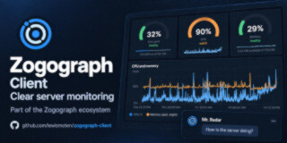](https://lewismoten.github.io/projects/zogograph-client/) | **Zogograph Client \| AI-assisted server monitoring** PHP and SQLite collectors with a JavaScript dashboard make server telemetry, alerts, and diagnostics readable, and an AI assistant calls diagnostic tools and tracks what an investigation costs. [Source](https://github.com/lewismoten/zogograph-client) · [Videos](https://www.youtube.com/watch?v=OKndBMPknmQ&list=PLaLeerEZeFMs) · [Case study](https://lewismoten.github.io/projects/zogograph-client/) |

### Browser tools and visualization

| Project image | Project |
| :--- | :--- |
| [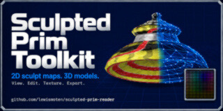](https://lewismoten.github.io/projects/sculpted-prim-toolkit/) | **Sculpted Prim Toolkit \| Three.js editor** Decodes Second Life-style RGB sculpt maps into editable 3D geometry in the browser, with exports to PNG, glTF/GLB, OBJ, and STL. [Live demo](https://lewismoten.github.io/sculpted-prim-toolkit/) · [Source](https://github.com/lewismoten/sculpted-prim-toolkit) · [Videos](https://www.youtube.com/watch?v=egAIXJwAAHw&list=PLIyz44ZkJ3sk) · [Case study](https://lewismoten.github.io/projects/sculpted-prim-toolkit/) |
|  | **Data Over Audio \| Web Audio API** Sends text and binary files through sound using MFSK, packets, CRC checks, Hamming error correction, interleaving, and repeat requests. [Live demo](https://lewismoten.github.io/data-over-audio/) · [Source](https://github.com/lewismoten/data-over-audio) · [Videos](https://www.youtube.com/watch?v=_6qxB3gKN_E&list=PLEyaach61fdU-OPcb5Aqgah2l6TTsaLia) · [Case study](https://lewismoten.github.io/projects/data-over-audio/) |
|  | **Emoji Explorer \| Unicode and pixel font** A localized, installable Unicode emoji explorer with sequence filters and offline support, plus a 12 x 12 Pixel Emoji font and an npm package of lookup packs. [Live demo](https://lewismoten.github.io/emoji/) · [Source](https://github.com/lewismoten/emoji) · [npm](https://www.npmjs.com/package/@lewismoten/emoji) · [Case study](https://lewismoten.github.io/projects/emoji/) |
|  | **QR Code Generator \| Creator and inspector** A browser tool backed by my own ES module for QR codes, with mixed segmentation, versions 1-40, Reed-Solomon correction, mask selection, and structural inspection. [Live demo](https://qr.lewismoten.com/) · [Source](https://github.com/lewismoten/qr) · [Case study](https://lewismoten.github.io/projects/qr/) |

### Publishing and interactive experiences

| Project image | Project |
| :--- | :--- |
| [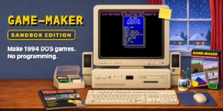](https://lewismoten.github.io/projects/gamemaker-sandbox/) | **Game-Maker: Sandbox Edition \| DOS engine port and visual editors** RSD Game-Maker 3.0 reimplemented and extended in TypeScript: original DOS file formats, browser editors, OPL2 audio, offline play, automated level checks, and an interactive 1994 desktop. [Live demo](https://lewismoten.github.io/GameMaker-SandboxEdition/) · [Source](https://github.com/lewismoten/GameMaker-SandboxEdition) · [Video](https://www.youtube.com/watch?v=0riemzdF8gc) · [Case study](https://lewismoten.github.io/projects/gamemaker-sandbox/) |
|  | **Dreamy Tags \| WordPress plugin** An open-source PHP and Gutenberg plugin that shows tag clouds filtered by category and tag, with exclusion rules and minimum-use thresholds. [Source](https://github.com/lewismoten/dreamy-tags) · [Plugin directory](https://wordpress.org/plugins/dreamy-tags/) · [Case study](https://lewismoten.github.io/projects/dreamy-tags/) |
|  | **Restoring the Signal \| Dialable exhibit** A live installation at Stone Branch Center for the Arts that joins a Raspberry Pi, Asterisk, and a PHP contribution site, with telephone audio, dialplans, transcription, and TTY support. [Live demo](https://phone.lewismoten.com/) · [Source](https://github.com/lewismoten/Phone-Exhibit) · [Videos](https://www.youtube.com/watch?v=kmOV7_2MKPg&list=PLHG0YVBnnA7k) · [Press and photos](https://www.nvdaily.com/nvdaily/dial-i-for-interactive-new-exhibit-celebrates-150-years-of-communication/article_06d37f43-5f2d-5ee3-9621-2dc1853ef4c2.html) · [Case study](https://lewismoten.github.io/projects/phone-exhibit/) |
|  | **Tiny Pockets Press \| Miniature publishing** A modular JavaScript editor for miniature books, with page layout, imposition logic, and separate interior and cover print and PDF views. [Live demo](https://lewismoten.github.io/Tiny-Pockets-Press/#editor) · [Source](https://github.com/lewismoten/Tiny-Pockets-Press) · [Videos](https://www.youtube.com/watch?v=w9IwuwX7BkE&list=PLAgk77H8yVCA) · [Case study](https://lewismoten.github.io/projects/tiny-pockets-press/) |
|  | **Shoomi's HomePage \| GeoCities restoration** A restoration of my first web page from the 1990s, with a Canvas recreation of its Java applet marquee, Web Audio MIDI playback, and a browser version of a Visual Basic color editor. [Live demo](https://lewismoten.github.io/Athens-Acropolis-4507/) · [Source](https://github.com/lewismoten/Athens-Acropolis-4507) · [Videos](https://www.youtube.com/watch?v=UgJgb0VUaHw&list=PLI4A73VhrZT4) · [Case study](https://lewismoten.github.io/projects/athens-acropolis/) |

### 8-bit retro Commodore 64 projects

| Project image | Project |
| :--- | :--- |
| [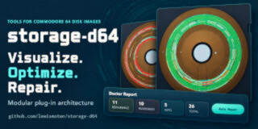](https://lewismoten.github.io/projects/storage-d64/) | **D64 Storage Lab \| Repair and optimization** A browser workbench that maps Commodore 64 disk sectors and file chains, estimates read efficiency, repairs corruption, restores deleted files, and compares optimized and fragmented layouts. [Live demo](https://lewismoten.github.io/storage-d64/) · [Source](https://github.com/lewismoten/storage-d64) · [Video](https://www.youtube.com/watch?v=cXeIy4AZewY) · [Case study](https://lewismoten.github.io/projects/storage-d64/) |
| [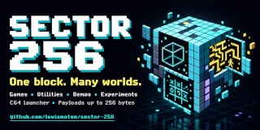](https://lewismoten.github.io/projects/sector-256/) | **Sector 256 \| Tiny programs for the C64** A graphical Commodore 64 launcher for games, utilities, demos, and experiments whose stored payloads are 256 bytes or less. [Live demo](https://lewismoten.github.io/sector-256/) · [Source](https://github.com/lewismoten/sector-256) · [Video](https://www.youtube.com/watch?v=dptHv4-RSWo) · [Case study](https://lewismoten.github.io/projects/sector-256/) |

### Government Transparency

| Project image | Project |
| :--- | :--- |
|  | **Stream Scribe \| Independent meeting archive and research** An independent archive and research tool for livestreamed government meetings: capture, local Whisper transcription, search, and annotation. Still in development. [Source](https://github.com/lewismoten/streamscribe) · [Case study](https://lewismoten.github.io/projects/stream-scribe/) |

### Earlier open source

Code I published in the 2000s, before the work above. The whole archive is on GitHub as [my Planet Source Code archive (2000s)](https://github.com/lewismoten/Lewies-Code-Library-PSC), and it has its own [browsable catalog](https://lewismoten.github.io/Lewies-Code-Library-PSC/Browse.htm).

| Project image | Project |
| :--- | :--- |
| [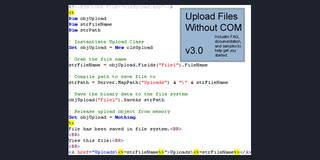](https://lewismoten.github.io/projects/upload-without-com/) | **Upload Files Without COM \| Classic ASP file uploads, 2001 to 2003** A pure-ASP parser for multipart form uploads, so a site on IIS could accept files without buying a COM component. [Source](https://github.com/lewismoten/Lewies-Code-Library-PSC/tree/master/ASP/UploadFilesWithoutCOMv3) · [OpenWiki attachment patch that uses it](https://sourceforge.net/p/openwiki/patches/1) · [2008 evolt.org thread: a developer used it on several client sites](https://lists.evolt.org/archive/Week-of-Mon-20080630/125069.html) · [My Planet Source Code archive (2000s)](https://github.com/lewismoten/Lewies-Code-Library-PSC) · [Case study](https://lewismoten.github.io/projects/upload-without-com/) |
| [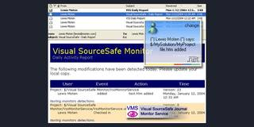](https://lewismoten.github.io/projects/vss-journal-monitor/) | **Visual SourceSafe Journal Monitor Service \| VB.NET Windows service, January 2004** A Windows service that watches a Visual SourceSafe database and sends alerts and daily reports, so a team in several time zones stops waiting on exclusive checkouts. [Source](https://github.com/lewismoten/Lewies-Code-Library-PSC/tree/master/VBNet/VSSMonitorService) · [My Planet Source Code archive (2000s)](https://github.com/lewismoten/Lewies-Code-Library-PSC) · [Case study](https://lewismoten.github.io/projects/vss-journal-monitor/) |
| [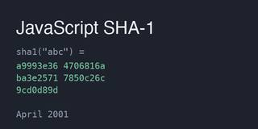](https://lewismoten.github.io/projects/javascript-sha1/) | **JavaScript SHA-1 \| A hash function in the browser, April 2001** A JavaScript port of the SHA-1 hash, published in April 2001, before its collision weaknesses were known. [Source](https://github.com/lewismoten/Lewies-Code-Library-PSC/tree/master/JavaScript/SecureHashAlgorithm(SHA-1)) · [My Planet Source Code archive (2000s)](https://github.com/lewismoten/Lewies-Code-Library-PSC) · [Case study](https://lewismoten.github.io/projects/javascript-sha1/) |

## Beyond code

I'm in the clown club at the Shrine in Manassas and perform for community events. I like projects that connect technology with something people can actually use, explore, or enjoy. I collect certifications, some serious (CPR/AED, BLS, Narcan) and some not (an honorary degree in comedic science).

I also created [The Bard of Bizarre](https://thebardofbizarre.com/), a multimedia project built around my lyrics and a 16-track concept album with AI-generated music and visuals. [Listen on Spotify and other services](https://distrokid.com/hyperfollow/thebardofbizarre/re-cubicle-13) · [Watch "Time Is a Flat Liar"](https://distrokid.com/videos/watch/dv-L9yj4VzE2)

My company is [Code Jamboree LLC](https://www.codejamboree.com/).

[More about me](https://lewismoten.github.io/about/) · [Schedule a conversation](https://calendly.com/lewismoten)
